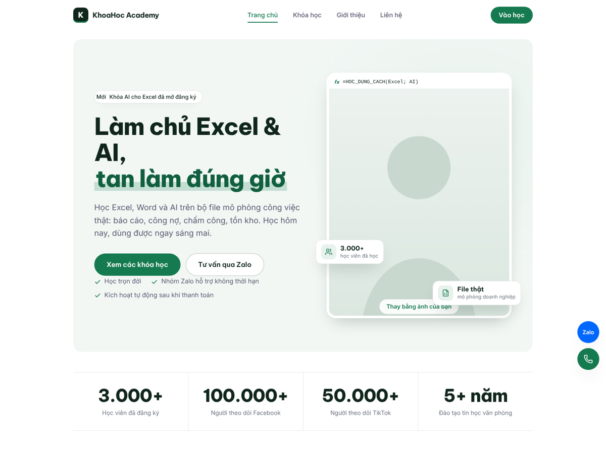

# KhoaHoc Academy: theme WordPress cho website khóa học

Theme WordPress viết bằng Tailwind CSS cho học viện hoặc trung tâm dạy online. Bố cục, màu sắc, cỡ chữ và khoảng cách lấy cảm hứng từ phuonghao.com. Nội dung, logo và hình ảnh là của bạn, sửa được hoàn toàn trong trang quản trị, không cần biết code.



## Có gì trong theme

| Tính năng | Bạn sửa ở đâu |
|---|---|
| Trang chủ với 12 khu vực (banner, số liệu, vấn đề, giới thiệu, lộ trình, khóa học, dự án thực chiến, cách dạy, phản hồi, kênh miễn phí, câu hỏi thường gặp, kêu gọi) | **Trang → Trang chủ**: bấm vào chữ để sửa trực tiếp |
| Quản lý khóa học: học phí, giá gốc, nhãn, lợi ích, video giới thiệu, nút đăng ký | **Khóa học → Thêm khóa học** |
| Giáo trình theo chương/bài, có bài "Học thử" | Trong nội dung khóa học: khối **Chương học** và **Bài học** |
| Form liên hệ/tư vấn: lưu vào admin và gửi email báo | Khối **Form liên hệ**. Xem tin nhắn ở menu **Liên hệ** |
| Hotline, Zalo, email, mạng xã hội, màu sắc, nút đầu trang, chân trang | **Cài đặt website** |
| Nút Zalo/Gọi nổi ở góc màn hình (mobile) | **Cài đặt website → Liên hệ** |
| SEO: meta description, ảnh chia sẻ Facebook/Zalo, schema Khóa học, FAQ, Breadcrumb | Tự động. Tự nhường cho Yoast/Rank Math nếu bạn cài |
| Google Analytics 4, Facebook Pixel | **Cài đặt website → SEO & đo lường** |
| Bán khóa học qua WooCommerce (không bắt buộc) | Nhập **ID sản phẩm WooCommerce** trong khóa học |

### Tốc độ
- Font Be Vietnam Pro và Inter lưu ngay trên hosting, chỉ tải bộ chữ Việt/Latin cần dùng, không gọi Google Fonts.
- CSS khoảng 10KB, JS khoảng 2KB (đã nén gzip). Không dùng jQuery ở giao diện ngoài.
- Icon Lucide nhúng dạng SVG, không tải bộ font icon.
- Video YouTube chỉ tải khi người xem bấm Play.
- Ảnh tự tải chậm (lazy load), có srcset. Ảnh banner được ưu tiên tải trước.
- Đã tắt emoji script và các thẻ thừa trong `<head>`.

### Hiệu ứng
- Banner có một hiệu ứng mở màn: chữ và ảnh trượt lên, 2 nhãn nổi nhẹ.
- Các khu vực hiện dần khi cuộn tới. Con số chạy từ 0.
- Câu hỏi FAQ mở/đóng có hiệu ứng.
- Người dùng bật "giảm chuyển động" trên máy thì toàn bộ hiệu ứng tự tắt.

## Cài đặt

1. Tải theme: trên GitHub bấm **Code → Download ZIP**.
2. Giải nén, **đổi tên thư mục thành `khoahoc`**, nén lại thành `khoahoc.zip`.
3. Vào WordPress: **Giao diện → Giao diện → Thêm mới → Tải giao diện lên**, chọn `khoahoc.zip`, rồi **Kích hoạt**.
4. Khi kích hoạt, theme tự tạo sẵn:
   - Trang **Trang chủ**, **Giới thiệu**, **Liên hệ**
   - 6 khóa học mẫu, chia theo danh mục
   - Menu đầu trang và 2 menu chân trang
5. Vào **Cài đặt → Đường dẫn tĩnh**, chọn **Tên bài viết**, bấm **Lưu**.
6. Vào **Cài đặt website** để nhập hotline, Zalo, email, Facebook, TikTok.

> Yêu cầu: WordPress 6.6 trở lên, PHP 7.4 trở lên.
> Muốn tạo lại dữ liệu mẫu: **Cài đặt website → Dữ liệu mẫu → Nhập dữ liệu mẫu**. Trang đã có sẽ không bị ghi đè.

## Hướng dẫn sửa nội dung (không cần code)

### Đổi logo
**Giao diện → Tùy biến → Nhận dạng site → Logo**. Nếu chưa có logo, theme hiện chữ cái trong ô vuông. Đổi chữ này ở **Cài đặt website → Thương hiệu**.

### Sửa trang chủ
1. Vào **Trang → Trang chủ → Chỉnh sửa**.
2. Bấm vào bất kỳ chữ nào để sửa.
3. **Bôi đậm** một chữ trong tiêu đề, chữ đó sẽ được tô màu nổi bật như trên website.
4. Muốn đổi ảnh hoặc chọn biểu tượng: bấm vào khối, cột bên phải hiện các tùy chọn.
5. Thêm khối mới: bấm dấu **+**, tìm nhóm **"Khối của theme"**.

| Khối | Dùng để |
|---|---|
| Banner đầu trang (Hero) | Tiêu đề lớn, mô tả, nút, ảnh, 2 nhãn nổi |
| Dãy số liệu | Các con số nổi bật (học viên, người theo dõi…) |
| Khu vực nội dung | Khung có tiêu đề nhỏ, tiêu đề lớn, mô tả. Kéo khối khác vào trong. Chọn được nền trắng hoặc nền xanh nhạt |
| Lưới thẻ + Thẻ | Thẻ có 6 kiểu: tính năng, vấn đề, bước lộ trình, ảnh, liên kết, gợi ý chọn khóa |
| Giới thiệu (ảnh + câu trích) | Ảnh người dạy và câu chuyện thương hiệu |
| Danh sách khóa học | Tự lấy từ mục **Khóa học**, kiểu thẻ lớn hoặc lưới |
| Ảnh phản hồi học viên | Lưới ảnh chụp tin nhắn, nhận xét |
| Câu hỏi thường gặp | Hỏi – đáp xổ xuống, tự tạo dữ liệu FAQ cho Google |
| Kêu gọi hành động | Khối nền đậm cuối trang, tự hiện hotline và email |
| Form liên hệ | Khách điền form, bạn nhận email và xem lại trong admin |
| Chương học / Bài học | Giáo trình trong trang khóa học |

**Menu cuộn tới một khu vực:** trong khối, mục **ID neo**, nhập ví dụ `khoa-hoc`. Trong menu, thêm link `/#khoa-hoc`.

### Thêm hoặc sửa khóa học
Vào **Khóa học → Thêm khóa học** và điền các phần sau:
- **Tiêu đề** và **Đoạn trích** (mô tả ngắn hiện trên thẻ khóa học).
- **Ảnh đại diện**: ảnh bìa trên thẻ lớn và khi chia sẻ Facebook.
- **Thông tin khóa học**:
  - Học phí và giá gốc (có giá gốc sẽ tự hiện số tiền tiết kiệm)
  - Nhãn, biểu tượng, dòng thông tin
  - Lợi ích: mỗi dòng một ý, `**chữ**` để in đậm
  - Link YouTube, link đăng ký
  - Ô **Khóa nổi bật**: tick để hiện thẻ lớn ở trang chủ
- **Thứ tự** (cột phải, mục Thuộc tính): số nhỏ hiện trước.

Nút **Đăng ký** đi theo thứ tự ưu tiên:
1. Link bạn tự nhập.
2. Thanh toán WooCommerce, nếu có nhập ID sản phẩm.
3. Mở Zalo.

### Xem khách để lại thông tin
Menu **Liên hệ** (có số đỏ báo tin mới) hiện danh sách khách. Mở từng khách sẽ có nút **Gọi** và **Nhắn Zalo**.

> Nếu không nhận được email báo, cài plugin **WP Mail SMTP**. Nhiều hosting chặn gửi mail mặc định.

## Bán khóa học, học viên và bài học bị khóa

Cần cài plugin **WooCommerce** (miễn phí): **Plugin → Cài mới → WooCommerce → Kích hoạt**. Lần đầu vào trang quản trị sau đó, theme tự cài đặt sẵn:
- Bật đăng ký tài khoản ở trang **Tài khoản** (có ô Họ tên, Số điện thoại) và bắt buộc có tài khoản khi thanh toán.
- Tiền tệ VND, trang **Tài khoản** của theme là trang tài khoản WooCommerce.
- Mỗi khóa học có học phí được tạo **1 sản phẩm ẩn**. Đổi tên hoặc giá khóa thì sản phẩm tự cập nhật theo.

**Nhận tiền chuyển khoản:** vào **WooCommerce → Cài đặt → Thanh toán → Chuyển khoản ngân hàng**, bật lên và nhập số tài khoản. Khi tiền về, mở đơn hàng và đổi trạng thái thành **Hoàn thành**: khóa học tự mở cho học viên, kèm email báo. Muốn tiền về là tự mở khóa, hoặc nhận VNPay/MoMo, thì cài thêm plugin cổng thanh toán (ví dụ SePay). Đơn bị **Hủy** hoặc **Hoàn tiền** thì khóa học tự bị thu hồi.

**Học viên thấy gì:**
| | Bài đầu tiên + bài "Cho học thử" | Các bài khác |
|---|---|---|
| Chưa đăng nhập | Bấm vào sẽ được mời đăng nhập/đăng ký rồi quay lại đúng bài | 🔒 khóa |
| Đã đăng nhập, chưa mua | Xem được **2 lượt**, hết lượt thì khóa (tải lại trong 30 phút vẫn tính 1 lượt) | 🔒 khóa, bấm vào hiện nút Đăng ký học |
| Đã mua (còn hạn) hoặc được admin mở | Xem được, mỗi video tối đa **2 lần** | Mở **lần lượt**: xem được 80% bài trước thì bài sau tự mở. Mỗi video xem tối đa **2 lần** |
| Khóa đã hết hạn | 🔒 khóa, hiện nút **Mua lại** (mua lại thì học từ đầu) | 🔒 khóa |

**Học theo lộ trình, thời hạn học, lượt xem** (sửa ở **Cài đặt website → Học viên & bài học**):
- **Học xong bài trước mới mở bài sau** (bật sẵn). Theme đếm số giây học viên thật sự đã xem (tua qua không tính); đủ **80%** thì bài sau tự mở (danh sách bài bên phải cập nhật ngay). Video YouTube, Vimeo, file .mp4 đo được tự động; video Google Drive/Bunny và bài tài liệu có nút **"Đã học xong"**, bấm được sau khoảng 1/3 thời lượng bài.
- **Thời hạn học mặc định: 12 tháng** kể từ ngày mở khóa (chọn Trọn đời / 3 / 6 / 12 / 24 tháng). Từng khóa đặt riêng ở ô **Thời hạn học** khi sửa khóa học. Combo: các khóa bên trong theo hạn của combo. Hết hạn thì khóa lại; mua lại sẽ học **từ đầu** (xóa tiến độ cũ).
- **Số lượt xem thử mỗi bài: 2** (nhập 0 = không giới hạn).
- **Số lần xem mỗi video sau khi mua: 2** (nhập 0 = không giới hạn). Mỗi lần mở bài tính 1 lượt; tải lại trang trong 30 phút vẫn tính 1 lượt. Hết lượt thì bài đó khóa, hiện nút **Liên hệ**. Bài tài liệu không tính lượt. Danh sách bài hiện "Còn 1 lượt xem" / "Hết lượt xem".
- Cho học viên xem thêm: **Tài khoản → Tất cả người dùng → Sửa** → tick **Đặt lại lượt xem** dưới khóa đó → **Cập nhật thành viên** (giữ tiến độ đã học). Mua lại khóa sau khi hết hạn thì lượt xem cũng tính lại từ đầu.
- Admin gia hạn cho học viên: **Tài khoản → Tất cả người dùng → Sửa** → mục **Khóa học đã mở** → tick **Gia hạn từ hôm nay** (giữ tiến độ đã học).
- Trang **Khóa học của tôi** hiện tiến độ (đã học x/y bài), hạn học, nút **Học tiếp** (mở bài đang học dở) hoặc **Mua lại** nếu đã hết hạn.

> Tiến độ lưu theo số thứ tự bài. Nếu chèn thêm bài vào giữa khóa đang có học viên, nên chèn ở cuối chương hoặc cuối khóa để không làm lệch tiến độ.

Học viên đăng nhập, đăng ký hay đăng xuất đều về **trang chủ** (riêng khi đăng nhập để học thử thì quay lại đúng bài đó). Học viên không vào được trang quản trị và không thấy thanh quản trị màu đen.

**Thêm video cho bài học:** trong khóa học, chọn khối **Bài học**, dán link vào ô **Link video bài học** ở cột phải. Nhận link YouTube (nên để "Không công khai"), Vimeo, Google Drive, Bunny Stream, file .mp4 hoặc mã `<iframe>`. Link chỉ hiện ra cho người được xem bài. Bật **Cho học thử miễn phí** nếu muốn mở thêm bài học thử ngoài bài đầu tiên.

**Combo:** trong khóa Combo, đánh dấu các khóa ở mục **Combo gồm các khóa**. Mua combo thì học được tất cả các khóa đó.

**Mở khóa thủ công** (ví dụ học viên chuyển khoản trực tiếp): **Tài khoản → Tất cả người dùng → Sửa** học viên → mục **Khóa học đã mở**, đánh dấu khóa cần mở rồi bấm **Cập nhật thành viên**.

**Học viên quên mật khẩu:** ở trang **Tài khoản** bấm **Quên mật khẩu?**, nhập email, mở link trong email để đặt mật khẩu mới. Khóa đã mua vẫn giữ nguyên. Cần website gửi được email (xem ghi chú WP Mail SMTP ở trên). Admin cũng có thể đặt mật khẩu mới cho học viên ở **Tài khoản → Tất cả người dùng → Sửa → Đặt mật khẩu mới**.

**Học viên mẫu để tự thử:** **Cài đặt website → Dữ liệu mẫu → Tạo học viên mẫu**. Theme tạo tài khoản `hocvien-demo` (email `hocvien-demo@example.com`), mở sẵn khóa "Excel từ cơ bản tới nâng cao" và hiện mật khẩu ngẫu nhiên **một lần**. Mở cửa sổ ẩn danh để đăng nhập thử. Bấm lại để đặt mật khẩu mới. Nhớ bấm **Xóa học viên mẫu** trước khi website chạy thật.

## Hệ thống thiết kế

| Token | Giá trị | Sửa được trong admin |
|---|---|---|
| Màu chính | `#157A4F` | Có |
| Màu tiêu đề | `#10261C` | Có |
| Màu nền đậm (CTA) | `#0E3B2B` | Có |
| Màu chữ thường | `#57586E` | |
| Nền nhạt | `#F2F7F4` | |
| Font tiêu đề | Be Vietnam Pro 600/700/800 | |
| Font nội dung | Inter 400/500/600 | |
| H1 / H2 / chữ thường | 56px / 42px / 16–19px (tự co nhỏ trên mobile) | |
| Khung nội dung | 1140px (khối nền), 1040px (nội dung) | |
| Bo góc | Thẻ 14px, khối 20px, nút bo tròn hoàn toàn | |

## Dành cho lập trình viên

```
khoahoc/
├── style.css                  # Thông tin theme
├── functions.php              # Nạp các file trong inc/
├── inc/
│   ├── setup.php              # Hỗ trợ theme, menu, font, CSS/JS, tối ưu tốc độ
│   ├── options.php            # Trang "Cài đặt website"
│   ├── post-types.php         # Khóa học, Danh mục, Liên hệ
│   ├── course-meta.php        # Ô "Thông tin khóa học"
│   ├── blocks.php             # Render PHP của 15 khối Gutenberg
│   ├── contact.php            # Form liên hệ + chống spam
│   ├── seo.php                # Meta, Open Graph, JSON-LD, GA4
│   ├── woocommerce.php        # Tương thích WooCommerce
│   ├── demo.php               # Dữ liệu mẫu khi kích hoạt
│   └── icons.php / icons-data.php  # Icon Lucide (SVG)
├── blocks/editor.js           # Giao diện soạn thảo các khối (JS thuần, không cần build)
├── src/app.css                # Nguồn Tailwind
├── assets/css/app.css         # CSS đã build (đã commit, hosting không cần Node)
├── assets/js/app.js           # Menu mobile, hiệu ứng, video, FAQ
├── assets/fonts/              # Font tự host
└── assets/img/                # Ảnh mẫu (SVG), thay bằng ảnh thật
```

**Build CSS sau khi sửa giao diện:**
```bash
npm install
```
```bash
npm run build
```
Hoặc dùng `npm run dev` để tự build mỗi khi lưu file.

**Đóng gói** (macOS/Linux, file nằm trong `dist/`):
```bash
npm run zip:theme    # dist/khoahoc.zip: tải lên WordPress (Giao diện → Tải giao diện lên)
npm run zip:source   # dist/khoahoc-source.zip: chép sang máy khác (có .git, không có node_modules)
```
Hướng dẫn đầy đủ đưa website lên hosting và chép sang máy khác: `docs/Huong-dan-KhoaHoc-Academy.docx` (Phần 3 và 4).

**Vì sao các khối render bằng PHP:** khối chỉ lưu dữ liệu (thuộc tính), HTML do PHP tạo khi hiển thị. Khi nâng cấp thiết kế, nội dung cũ không bị lỗi "khối không hợp lệ".

**Bảo mật form:** có nonce, ô bẫy bot (honeypot), chặn gửi nhanh dưới 3 giây, giới hạn 1 lần/30 giây mỗi IP. Mọi dữ liệu đều được làm sạch trước khi lưu.

## Giấy phép
GPL-2.0-or-later. Icon [Lucide](https://lucide.dev) (ISC). Font Be Vietnam Pro và Inter (SIL OFL).
